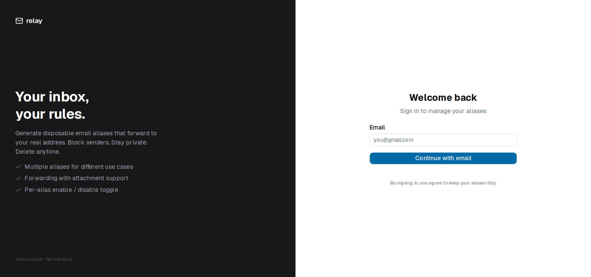

# relay


<!--  -->
<!--  -->

Create disposable email aliases that forward to your real inbox. Keep your address private, reply anonymously, disable aliases you no longer need, and stay in control.



---

## Getting started

```bash
cp .env.example .env    # fill in the values, see Configuration
```

`pnpm dev` reads `web/.env`, not the root `.env`, so also create `web/.env` with:

```bash
NEXT_PUBLIC_CLERK_PUBLISHABLE_KEY=pk_test_...
NEXT_PUBLIC_API_URL=
```

Then run the backend and frontend in two terminals:

```bash
go run ./cmd/server               # terminal 1
cd web && pnpm install && pnpm dev  # terminal 2
```

Open http://localhost:8080. The Go server serves the API and proxies everything else to Next.js on port 3000.

Or with Docker, which also starts Postgres:

```bash
docker compose up --build
```

## Configuration

Copy `.env.example` to `.env` and fill in the values.

| Variable | Description |
|---|---|
| `PORT` | Server port (defaults to `8080`) |
| `DATABASE_URL` | Postgres connection string |
| `DB_USER`, `DB_PASSWORD`, `DB_NAME` | Postgres credentials, only used by `docker compose` |
| `CLERK_SECRET_KEY` | Clerk secret key, verifies sessions |
| `NEXT_PUBLIC_CLERK_PUBLISHABLE_KEY` | Clerk publishable key (build arg, baked into the frontend) |
| `SMTP_DOMAIN` | Domain for alias addresses |
| `MAILGUN_API_KEY` | Mailgun private API key |
| `MAILGUN_DOMAIN` | Mailgun sending domain (defaults to `SMTP_DOMAIN`) |
| `MAILGUN_SIGNING_KEY` | Mailgun webhook signing key, verifies inbound mail |
| `MAILGUN_API_BASE` | Mailgun API base URL (use the EU endpoint for EU accounts) |
| `FRONTEND_URL` | Allowed CORS origin, only matters if the frontend is hosted separately |
| `NEXT_PUBLIC_API_URL` | API URL if the backend is hosted separately (build arg, leave empty otherwise) |

## Setup

**Clerk.** In the Clerk dashboard, enable **Email address** with **Email verification code** as the sign-in method, and turn off passwords and social providers. A production instance sends the codes from your own domain once you add the DNS records Clerk lists. On Cloudflare, set those records to DNS only.

**Allowed email providers.** Only addresses from big providers can sign in: Gmail, iCloud, Outlook/Hotmail, Yahoo and Proton. The list lives in `internal/auth/domains.go`, and `web/src/lib/allowed-emails.ts` keeps a copy for the form's pre-check. Change both together.

**Mailgun.** Add an inbound route for `SMTP_DOMAIN` that forwards to `https://<your-app>/api/webhooks/email`.

<!-- ## API

```
GET    /api/users/me                 get current user
DELETE /api/users/me                 delete account

GET    /api/aliases                  list aliases
POST   /api/aliases                  create alias
PATCH  /api/aliases/:id              update alias
DELETE /api/aliases/:id              delete alias

POST   /api/webhooks/email           inbound email webhook
``` -->

## License

MIT
